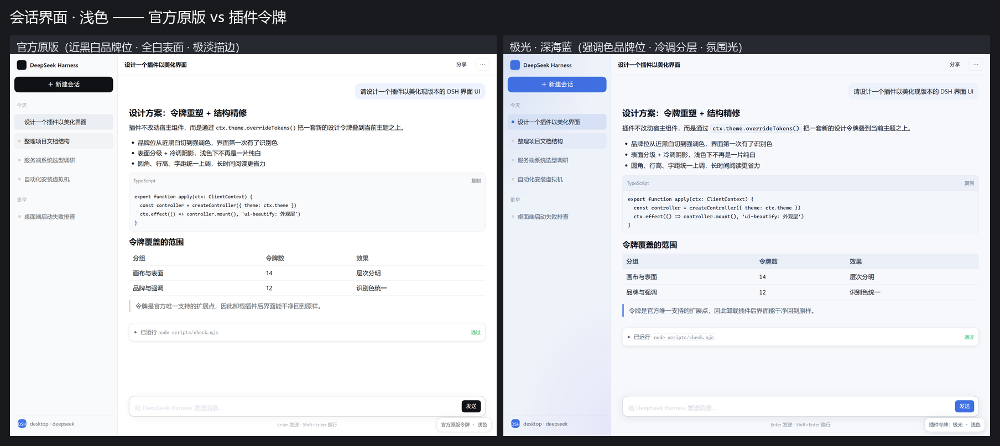
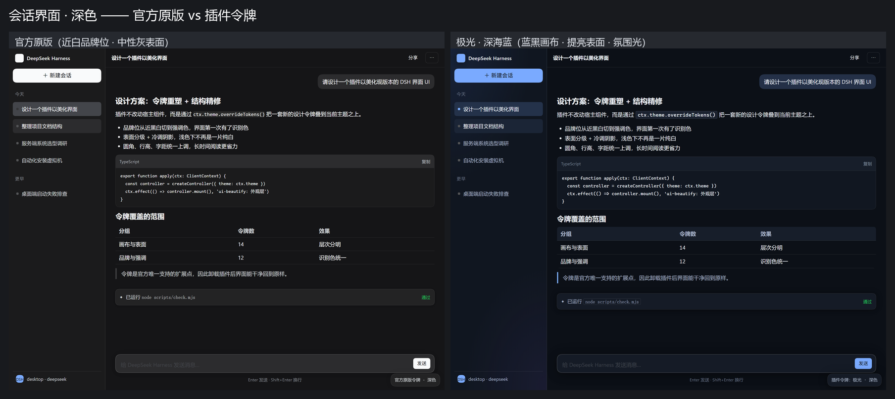
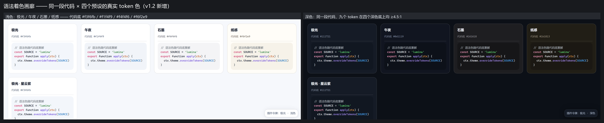
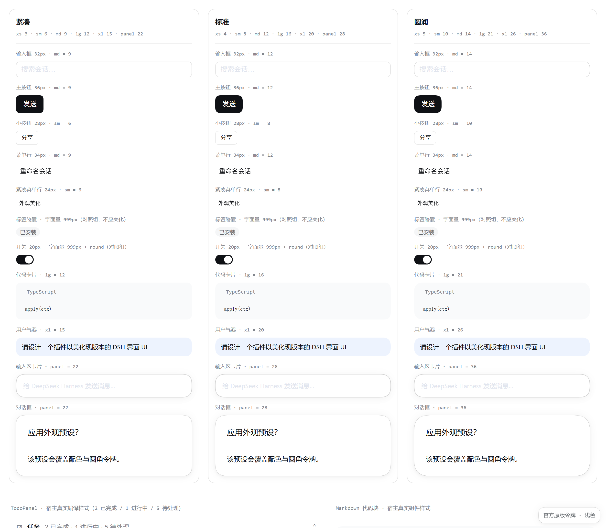
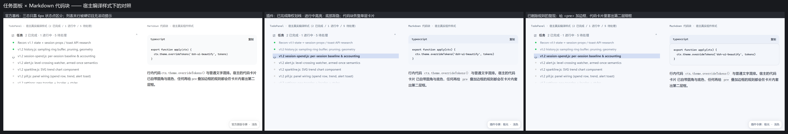
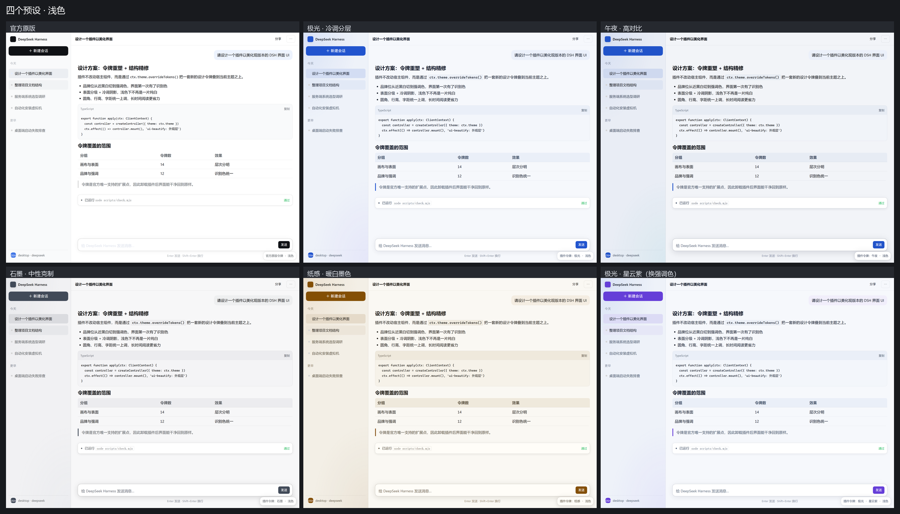
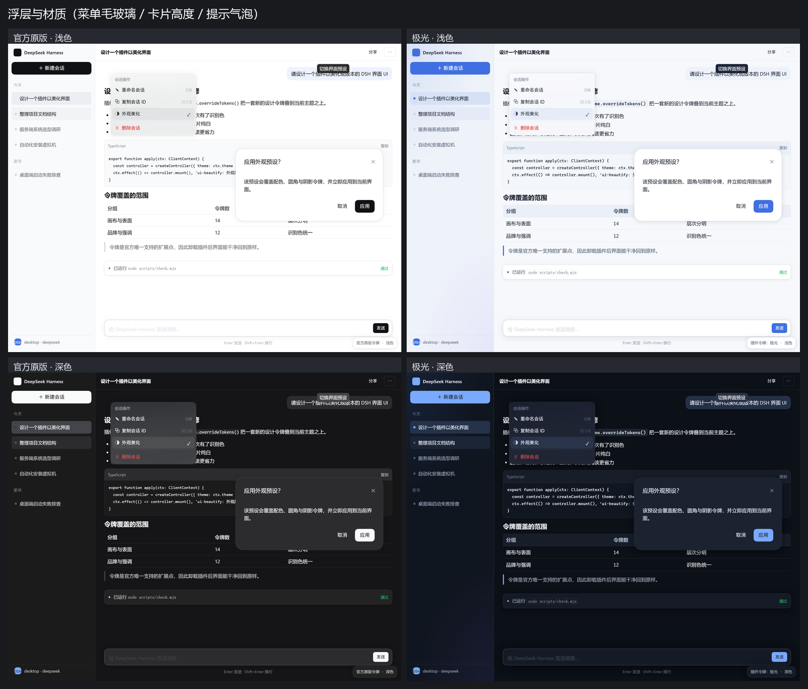
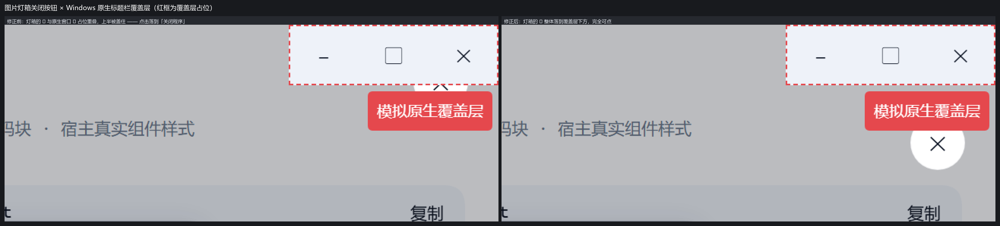
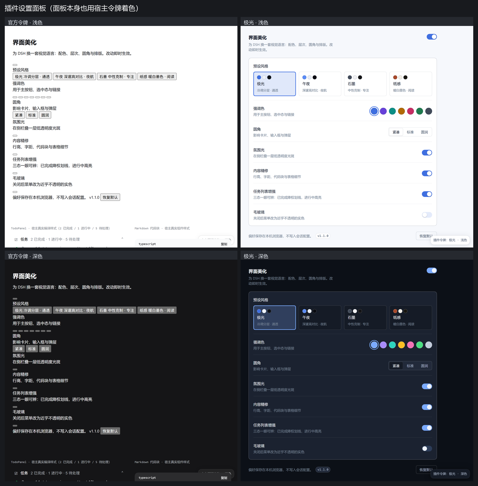

# 界面美化 · Lumina（`dsh-ui-beautify`）

给 DeepSeek Harness Web 界面换一套视觉语言的客户端插件：**配色身份、表面层次、
几何圆角、内容排版**四件事同时收紧，并提供可视化外观设置面板。

仓库：<https://github.com/PinBoDHua/dsh-ui-beautify>

- 走官方唯一支持的扩展点 `ctx.theme.overrideTokens()`，**不劫持组件、不改宿主代码**；
- 卸载或关闭总开关后界面**零残留**地回到官方原样（卸载时会调用宿主返回的撤层函数）；
- **配色不是手调的，而是解出来的**：凡承载文字的颜色都过一遍 WCAG 达标求解，
  构建期对全部 56 种组合做 **9072 次**对比度断言；
- **连「有没有漏掉某条断言」也是算出来的**：扫描宿主全部样式与 51 个客户端 bundle
  得到消费点索引，被当文字色消费、插件又覆盖了的令牌必须有归属 ——
  这条护栏在 v1.3 一次性找出 8 个从未被断言的令牌与一整族漏掉的语义色；
- 顺手补上宿主自己缺的两个令牌（错误提示文字、第四级表面），以及一个点下去会
  关掉程序的灯箱按钮；
- **改坏宿主布局的令牌一律不许碰**：v1.4 修掉了一个藏在「四条检查的交集为空」
  处的缺陷 —— 插件把宿主拿来做布局的 `--dsh-scrollbar-width` 从 5px 改成 6px，
  轨迹视图里的输入框因此与点击命中位置差半像素。现在有断言扫描所有落在
  `html`/`body` 根作用域的宿主令牌赋值，未登记的一律构建失败；
- 手写客户端 bundle，**不引入任何第三方依赖**，构建脚本零 npm 包；
- 自带静态审计 + 运行时集成测试 + Chromium 渲染验证台。



---

## 它改变了什么

官方主题是一套**近乎单色**的设计：浅色下主按钮是近黑（`#0f1115`），深色下是近白
（`#f9fafb`），表面三层同为纯白，描边只有 4%–10% 的黑。沉静、耐看，但也意味着
界面**没有识别色**，浅色模式下层次靠一根几乎看不见的发丝线撑着。

本插件做四件事：

| 维度 | 官方 | 美化后 |
| --- | --- | --- |
| 品牌位 | 近黑 / 近白 | 用户选定的强调色（默认深海蓝 `#3f6fe0` / `#7aaaff`） |
| 表面层次 | 三层同色 | 画布 / 表面 / 浮层分级，冷调或暖调成套 |
| 阴影 | 中性黑，极淡 | 带色相的阴影阶，高度可辨 |
| 选中态 | 灰底 | 强调色**淡染**（13%），长期驻留不刺眼 |
| 圆角 | 12 / 16 / 28 | 可切三档，全部令牌联动；形状（正圆 / 方圆形）另算一条轴 |
| 排版 | 行高 24px | 行高 25px + 标题阶梯同步上调 + 等宽数字；字号另算一条轴（13 / 14 / 16px） |
| **代码高亮** | 九色写死，浅色下 6 个不达 AA | **随预设重解**，全部 ≥4.5:1 |
| **语义色** | 绿 / 琥珀 / 红三族写死，浅色下最差 **1.91:1** | **随预设重解**（色相锁死），最差 5.1:1 |
| **差异视图** | 新增行正文 1.91:1、删除行 3.56:1 | 6.3 / 5.1 以上，底色也随预设走 |



### 可读性：配色不是调出来的，是解出来的

这是 1.2 的主题。上一版的每个色值都是手写的 —— 在「默认预设 + 默认强调色」下
看着没问题，但组合有 **4 预设 × 7 强调色 × 2 明暗 = 56 种**，手调覆盖不了。
把这 56 种组合逐对算过 WCAG 对比度之后，找到 6 处真实缺陷，最严重的一处是
**字完全消失**：

> 宿主把 `--dsw-specific-sidebar-nav-item-active-accent` 当徽标**底色**用
> （`ui-user-questions`：`.badge { background: 该令牌; color: var(--dsw-alias-button-info-fill) }`）。
> 上一版把这个令牌写成了完整强调色，而 `button-info-fill` 也是同一个强调色 ——
> 于是徽标的字与底一模一样，**对比度 1.00**。

现在配色这样产生：

| 环节 | 做法 |
| --- | --- |
| **契约** | `readability.js` 声明 82 条「谁压在谁上、最低多少」，是唯一真相来源 |
| **求解** | `color.js` 沿明度轴把颜色移到达标位置，**保持色相**；已达标则原样返回 |
| **护栏** | `scripts/check.mjs` 对 56 种状态 × 2 明暗跑 **9072 次断言**，不达标即构建失败 |
| **覆盖面** | `scripts/audit-consumers.mjs` 扫描宿主全部样式与 bundle，`check.mjs` 断言「被当文字色消费的令牌必须进契约或显式豁免」 |
| **可见** | 设置面板里显示当前组合的最低对比度与达标状态 |

发布前又跑了一轮**独立的对抗性复核**（自己重写一套 WCAG 计算、不调用本仓库的
评估器）：6 项声明全部证实，包括把三个不同类别的违规注入副本、确认
`check.mjs` 真的以非零退出 —— 护栏不是摆设。复核同时找出 2 处漏网的令牌，
见下面的「占位文字」与「快捷键键帽」。

求解只动明度、不动色相：你选的「碧波青」求解后**还是碧波青**，只是深了一点
（实测最多 11% 明度，色相偏移 ≤0.81°）。已经达标的颜色一律原样返回 ——
14 组「强调色 × 明暗」里有 5 组逐字节未改（深色下多数如此，浅色下石墨灰也是），
它们在四个预设上重复，因此 56 组里共 20 组未动。其余的不是「统一压暗一遍」，
而是各自解到自己刚好达标的位置。

契约里有两条容易被忽略、但确实存在的约束：

- **自指约束**：淡染层（Tag 语气、徽标底、侧栏选中底）由强调色自己派生，
  而它上面又要压强调色文字 —— 背景依赖求解目标本身，所以要迭代两轮收敛。
- **fallback 是声明，不是猜测**：`--dsw-alias-label-primary-foreground`
  （白字 / 近黑字）由主按钮、开关滑块、StateDot 共用，插件**有意不覆盖**它，
  改为让强调色去满足它。这个取值在契约里显式登记，并有断言确保它真的没被覆盖 ——
  否则 fallback 就是一段死代码。

### 覆盖面：把「有没有漏掉」也变成一条会失败的断言

这是 1.3 的主题。上一版自己记下了最大的教训：

> **写下一份 41 条的清单，不等于覆盖了 117 个令牌。**
> 117 个令牌里有 77 个没有被任何配对引用 ——「4704 次断言」描述的是配对层的
> **深度**，不是令牌层的**广度**。

把清单写长一点解决不了这个问题：漏哪一条取决于**宿主在哪里用了这个令牌**，
而那是插件之外的事实。于是 1.3 先把这个事实变成数据 ——
`scripts/audit-consumers.mjs` 扫描宿主的全部样式表与 51 个客户端 bundle
（298 个文件 / 2244 条规则），产出「哪个令牌被用在哪个属性上、字号多少」的索引，
`check.mjs` 再据此断言：

| 断言 | 它挡住什么 |
| --- | --- |
| **覆盖率** | 被宿主当文字色消费、插件也覆盖了，却既不在契约里、也没写明为什么的令牌 |
| **豁免不过期** | `UNCOVERED` / `DELIBERATE` / `HOST_GAPS` 三张表指向已覆盖、已消失或不存在的令牌 |
| **fallback 取值** | `HOST_FALLBACK` 抄错官方取值 —— 契约会拿它当真实生效值算对比度 |
| **可行域** | `INFEASIBLE` 声称的「方向冲突」不再成立（那就该把配对写回契约） |

这套机制第一次跑起来就找出：

- **一整族漏掉的语义色**：`Tag` 的 info 语气在 1.2 里被认真求解过，而同一张
  样式表里**隔三行的兄弟规则**（success / warning / danger）一条都没被算 ——
  实测「通过」徽标 2.06:1、**差异视图新增行的正文 1.91:1**，而面板上写着「全部达标」；
- **8 个「覆盖了但从未被断言」的令牌**，例如 `--dsw-alias-label-primary-dimmed`
  （宿主拿它当 14px 次级正文）与 `--dsw-alias-bg-layer-3`（宿主拿它当**文字**：
  Tag 的 solid 语气、构建号胶囊、工具提示）；
- **两处宿主自己缺的令牌**（见下）。

### 语义色：与强调色相反的一套规则

强调色的色相由用户挑，只有明度可解；语义色的色相是**约定** —— 绿 = 成功、
琥珀 = 警告、红 = 危险。把「危险」换成紫色，界面就不再可信。因此语义色
**色相与饱和度都锁死**，只沿明度轴移到读得出来，构建期还有一条断言把 168 组
取值钉在各自的约定色域里。

| 位置 | 宿主取值 | 修复前 | 修复后 |
| --- | --- | --- | --- |
| Tag success 语气 | `#22c55e` | 2.06:1 ✗ | 6.2–6.4:1 ✓ |
| Tag warning 语气 | `#f59e0b` | 1.94:1 ✗ | 6.3–6.5:1 ✓ |
| Tag danger 语气 | `#ec1313` | 3.77:1 ✗ | 5.1–6.2:1 ✓ |
| 连接指示 · 成功 / 警告 | `#22c55e` / `#dd8629` | 2.09 / 2.58 ✗ | 6.2–8.6 ✓ |
| **差异视图 · 新增行正文** | `#22c55e` | **1.91:1** ✗ | 6.3–8.9:1 ✓ |
| 差异视图 · 删除行正文 | `#ec1313` | 3.56:1 ✗ | 5.1–8.1:1 ✓ |

差异视图的整行底、行号槽与左侧标记（九支令牌）也一并由同一支语义色在画布上派生 ——
宿主的 `#e6f4e7` / `#01a241` 是写死的冷绿，落在纸感（暖白）与午夜（冷黑）上都很突兀。

### 悬停底：4680 组里 969 组曾经低于自己的档位

宿主动辄把 `--dsw-alias-interactive-bg-hover` 铺在文字底下
（`Menu.module.css` 的 `.item:hover`，同一行里还有 11px 的快捷键与标签文字）。
深色模式下强调色是亮色，那层 12% 的罩层把深底**提亮**，同一段灰字的有效底就变了：
石墨 + 石墨灰 + 深色下，卡片上的说明文字掉到 **2.06**（目标 3）、三级文字 **3.06**（4.5）。

修法是把两层罩层合成到每一支平面底上、加进求解的输入集。**哪几级进得了这个
约束集是算出来的**：罩层提亮之后，最亮的那层相对亮度 0.057，**纯白对它也只有
9.8:1** —— 因此 primary(12) 与 dimmed(9) 数学上不可能达标，它们保持对平面表面
求解、在瞬态底上退到 AAA(7) 与下一级的稳态底线(5.5)（实测最低 8.29 与 6.80）。

### 两处宿主缺口的修正

消费点索引还列出「有消费者、却从未声明」的令牌（本机 38 个），其中两个的后果
是可见的 —— `color: var(--某令牌)` 在计算值阶段成为 guaranteed-invalid，
于是按 `unset` 处理，而屏幕上不会报任何错：

| 令牌 | 谁在消费 | 缺失的后果 |
| --- | --- | --- |
| `--dsw-alias-label-error` | 设置表单的保存失败提示 | 提示文字**继承正文墨色**，「保存失败」与普通说明长得一模一样 |
| `--dsw-alias-bg-layer-4` | 设置表单「?」帮助按钮的 `:hover` | 底色落到 `transparent`，悬停没有任何反馈 |

修法与下面那条灯箱修正同属一类：不改宿主，只把它漏掉的那一格填上。
这两条没有开关 —— 它们不是换肤。

### 契约管不到的地方，就是问题藏着的地方

这一版最值得记的一条教训来自**发布前的独立复核**：它找出两处漏网，而且都不是
「算错了」，是**根本没被算**。

| 漏网 | 实际情况 | 现在 |
| --- | --- | --- |
| `--dsw-alias-label-dimmed` | 被绑成描边色，而宿主拿它当 **14px 输入框占位文字**：实测 1.48–2.00:1，连 3:1 都不到，41 条配对里**没有一条覆盖它** | 按正文求解到 AA（最低 5.23），并补上契约配对 |
| 快捷键键帽 vs 气泡底 | 阈值写着 1.3，而实测从未低于 1.7 —— 永远不可能失败的断言；收紧到官方水平 2.0 后才发现实际只有 **1.75，比官方还难分辨** | 按 2.0 求解（最低 2.000） |

两条都说明同一件事：**断言的覆盖面本身才是最容易被忽略的东西**。
所以这版还加了一条前置断言 —— 检查每个预设的墨色与表面色之间留有足够明度间隔，
因为求解器的二分搜索只在那个前提下单调；将来有人加一个中间调的预设，
它会先失败，而不是让求解器悄悄给出劣解。

### 代码高亮也跟着预设走

宿主的九个 `--shiki-token-*` 写死在 `shiki.css` 的 `:root` 上，深浅两套都与主题
绑定、却不随插件预设走。插件把代码块底色换成预设色之后，它们就落在一个从未被
设计过的底上 —— 浅色下**九个里有六个低于 AA**，最差的注释只有 2.97（官方底上
本来也只有 3.18，纸感更暖的底又低了 0.21）。现在这九个 token 按当前代码底逐个
求解，色相保持：同一段代码在四个预设下都读得出来，且「关键字偏红、字符串偏绿」
这套语言没有变。



### 圆角

宿主自带一套 4 / 8 / 12 / 16 / 20 / 28 的半径阶梯，插件在此基础上给出三档
**逐档设计值**（不是统一乘数）：

| 令牌 | 用在什么上 | 紧凑 | 标准 | 圆润 | 宿主 |
| --- | --- | --- | --- | --- | --- |
| `xs` | 行内代码、小标记 | 3 | 4 | 5 | 4 |
| `sm` | 24–28px 小控件 | 6 | 8 | 10 | 8 |
| `md` | 32px 输入框、34–36px 按钮/菜单行 | 9 | 12 | **14** | 12 |
| `lg` | 卡片、代码块、内容区左上角 | 12 | 16 | 21 | 16 |
| `xl` | 用户气泡、文件卡片 | 15 | 20 | 26 | 20 |
| `panel` | 输入区卡片、对话框 | 22 | 28 | 36 | 28 |

**形状是另一条轴**。宿主自带 `theme/corner_shape.css`，在支持该属性的浏览器上
把所有圆角做成**方圆形**（`superellipse(1.5)`，苹果那种更饱满的圆角），并交给
一个令牌控制：`* { corner-shape: var(--dsw-corner-shape) }`。插件给你三档：

| 档位 | 取值 | 说明 |
| --- | --- | --- |
| **正圆** | `round` | 经典圆弧，切口更利落 |
| **方圆形**（默认） | `superellipse(1.5)` | **与官方完全一致**，因此默认不改变现有观感 |
| **硬朗** | `superellipse(2.4)` | 更接近方角，大圆角上轮廓更「紧」 |

圆形按钮与胶囊（StateDot、Pill、Switch、Tag、滚动条滑块）不受影响：宿主自己
把它们钉在 `corner-shape: round`，那是刻意的（正圆才像圆），插件不去动它们。

**内容区左上角那个圆角曾经是死的**：插件用 `html body [class*='_frame']` 覆盖它，
座标 `(0,1,2)`，而宿主是 `[data-windows-titlebar] .BynINW_frame`，座标 `(0,2,0)`。
**属性选择器与类同级**，1 < 2 —— 宿主赢，那条规则从未生效，圆角档位对它完全无效。
它躲过全部检查的原因是默认档恰好也是 16px。现在写成
`html[data-windows-titlebar] body […]`（`(0,2,2)`），并有一条断言盯着这个形状。

**为什么不用统一乘数**：宿主的 `md` 同时用在 32px 高的输入框和 36px 高的按钮上。
统一乘 1.4 得到 17px，超过 32px 输入框的半高（16px），输入框会塌成胶囊 ——
这正是第一版「圆润」档的真实后果。现在 `md` 锁定在 14px（占 32px 的 44%），
三档的差异主要落在大表面上，小控件只做小幅调整。

这条约束写成了 `scripts/check.mjs` 里的断言（单调性 + `md` 上限 +
内容区圆角对齐 `lg`），避免下次「顺手把圆润档再调大一点」时又踩回去。
`verify/out/compare-corner.png` 与 `verify/out/radius-*.png` 是可视证据：
画廊里还刻意放了两组**不应该变化**的对照件（标签胶囊、开关），
它们用字面量 `999px` + `corner-shape: round`，不受圆角令牌影响 ——
如果它们跟着变，说明选择器写错了。



### 任务列表增强

宿主的任务面板（composer 上方的「任务 N 已完成 · M 进行中 · K 待处理」）三态在视觉上
几乎不可分：任务项文字**恒为同一种灰**，状态只由一个 6px 状态点承担 —— 已完成绿点、
进行中转圈、待处理灰点。十几行排下来扫一眼，得到的印象是「都差不多」，
于是「到底做完了没有」在面板上读不出来。

插件把状态差从「6px 圆点」放大到「整行可辨」：

| 状态 | 表现 |
| --- | --- |
| 已完成 | 文字降权 + 删除线（划线用描边色，不抢正文注意力） |
| 进行中 | 强调色淡染行底 + 左侧强调条 + 文字加重 |
| 待处理 | 保持宿主原样 —— 它是基线，另外两档的差异才有参照物 |

顺带修掉列表溢出：`max-height: 180px` 配 28px 行高不是整数倍，最后一行常被硬切成
两半，且没有任何「还能滚」的提示，看起来像渲染坏了。现在列表底部有 12px 渐隐，
并在末尾留出与渐隐等高的空白 —— 滚到底时渐隐落在空白上，**最后一行不会被误伤**。



全部通过宿主有意暴露的 `data-testid="todo-panel"` 与 `data-status`
（`completed | in_progress | pending` 封闭联合）定位，**不碰任何编译哈希类名**。

> **一个必须说清的边界**：面板头部的计数由宿主的 todo 投影直接决定。
> 如果它显示「10 待处理」，那是**数据**里确实一条 completed 都没有 ——
> agent 更新待办时没有标记完成，CSS 变不出完成态。插件只负责让已有状态**读得出来**，
> 不负责修正数据。

### 四个预设

| 预设 | 气质 | 适用 |
| --- | --- | --- |
| **极光** `aurora` | 冷调分层 · 通透 | 默认，长时间阅读 |
| **午夜** `midnight` | 深邃高对比 · 夜航 | 暗环境、外接显示器 |
| **石墨** `graphite` | 中性克制 · 专注 | 不想改变官方色相，只要层次与几何 |
| **纸感** `paper` | 暖白墨色 · 阅读 | 白天、长文档 |



七个强调色与预设**正交**：先挑骨架，再挑识别色。
`极光 + 星云紫` 与 `极光 + 深海蓝` 是两套气质，而不是同一个主题的深浅变化。



---

## 安全修正：图片灯箱的 ✕ 不再会关掉程序

这一条不是美化，是修宿主的一个真实缺陷。Windows 上宿主用 Electron 的
`titleBarOverlay` 画最小化/最大化/关闭三个按钮 —— 它们**不在 DOM 里**，
由 Chromium 绘制在页面**之上**，占位约 `top: 0–40px`、`right: 0–138px`。

而图片灯箱的关闭按钮被固定在 `top: 20px; right: 20px`（36×36），
**整块落在那三个原生按钮的下半部分里**。因为原生层在上，点击被它截走：

> 你打开一张图，看着右上角的 ✕ 点下去 —— 关掉的是整个程序。

宿主自己发布了 `--dsh-frame-overlay-top`（= 标题栏高度 + 20px）正是给这类浮层用的，
灯箱没用它。插件用一条规则把它接回去：

```css
html[data-windows-titlebar] body [class*='_backdrop'] [class*='_close_'] {
  top: var(--dsh-frame-overlay-top, 60px);
}
```

- 位移量引用宿主变量而非写死：全屏时宿主会把该变量降回 20px，
  而全屏下原生按钮本就不显示，关闭按钮自动回到原位；
- 只在 Windows 标题栏模式下生效，macOS 与浏览器访问不受影响；
- 选择器用与哈希无关的后缀匹配（编译后是 `_backdrop_1hos8_1` / `_close_1hos8_29`），
  全应用只有一个 `_backdrop` 类，匹配不到时静默降级 ——
  宿主哪天自己修好了，这条规则自动失效。



`scripts/audit-caption-collision.mjs` 会全量扫描宿主样式，找出所有「固定定位且
落在覆盖层占位内」的控件。当前扫描 162 个文件，**命中 1 条**，就是这一处。

---

## 安装

### 前置

- DeepSeek Harness Desktop（本插件针对 `0.2.0-rc.2` 客户端契约开发）；
- 插件目录已就位（本仓库根目录即为插件包）。

### 方式一：用 DSH 自带 CLI（推荐）

`desktop` 是 Electron 独占的保留 profile，npm CLI 拒绝管理它，必须用内置 CLI。
**先完全退出 DeepSeek Harness 桌面端**（profile 有写锁，CLI 最多等 120 秒）。

```powershell
& "D:\deepseekharness\resources\runtime\cli\bin\dsh.cmd" plugin --profile desktop add "file:D:/Questions/dsh-ui-beautify"
```

CLI 会把它装进 profile 的 `node_modules`，并因为本包声明了 `dsh.bundle.patch`
而自动追加到 `dsh.profile.bundles`。装完重新打开应用即可。

### 方式二：手工接入

1. 把整个 `dsh-ui-beautify` 目录复制到
   `C:\Users\<你>\.dsh\profiles\desktop\node_modules\dsh-ui-beautify`；
2. 在 `C:\Users\<你>\.dsh\profiles\desktop\package.json` 的 `dependencies` 里加
   `"dsh-ui-beautify": "file:D:/Questions/dsh-ui-beautify"`；
3. 在同一个文件的 `dsh.profile.bundles` 数组末尾加 `"dsh-ui-beautify"`；
4. 重启 DeepSeek Harness。

> 第 3 步不可省略：`dsh.client` 的发现锚点是**宿主侧的 loader 条目**，
> 而条目来自 `cordis.patch.yml`，只有进了 `bundles` 才会被应用。

### 卸载

```powershell
& "D:\deepseekharness\resources\runtime\cli\bin\dsh.cmd" plugin --profile desktop remove dsh-ui-beautify
```

或手工反向执行上面的三步。因为插件只通过官方扩展点改令牌，卸载后没有任何
需要清理的样式残渣。

---

## 使用

装好后进入 **设置 → 界面美化**：



| 控件 | 说明 |
| --- | --- |
| **总开关** | 关闭即整套撤回：令牌层清空、六张样式表移除、`data-dshb-*` 属性清空 |
| **预设风格** | 四套骨架，各含明暗两套完整配色 |
| **强调色** | 七个色相；浅色/深色分别调校，并各自**求解到 WCAG AA**（色相不变） |
| **圆角** | 紧凑 / 标准 / 圆润三档**逐档设计值**，联动全部 `--dsw-radius-*` |
| **圆角形状** | 正圆 / 方圆形（默认，与官方一致）/ 硬朗；圆形按钮与胶囊不受影响 |
| **内容字号** | 紧凑 13 / 舒适 14（默认，与官方逐字节一致）/ 大字 16；仅作用于消息正文与标题阶梯 |
| **可读性**（只读） | 当前组合的最低对比度与达标状态，数值来自与构建期同一份契约 |
| **氛围光** | 侧栏叠一层低透明度光斑 |
| **内容精修** | 行高、字距、等宽数字、代码块与表格细节 |
| **任务列表增强** | 三态一眼可辨：已完成降权划线，进行中高亮 |
| **毛玻璃** | 关闭后菜单改为近乎不透明的实色填充 |
| **过渡动效** | 仅过渡颜色类属性，绝不加在布局属性上 |

语义色（成功 / 警告 / 危险）**没有开关**：它们不是一种口味，而是一处与 1.2 同类
（甚至更明显）的可读性缺陷 ——「通过」徽标的正文、差异视图里每一行新增代码的正文，
都是要被读的内容。1.2 也没有为「把字解到达标」提供开关。

页脚显示**当前版本号**——插件走热替换，没有可见版本号就只能靠猜「我到底装上了没有」。

改动**即时生效**，偏好保存在本机 `localStorage`（键 `dsh-ui-beautify:prefs:v1`），
不写入会话配置。**恢复默认**一键回到出厂外观。

### 公开状态标记

面板之外，插件在 `<html>` 上发布三个属性，方便你自己写补充样式：

| 属性 | 取值 | 用途 |
| --- | --- | --- |
| `data-dshb-preset` | `aurora` / `midnight` / `graphite` / `paper` | 针对某个预设写补充规则 |
| `data-dshb-radius` | `compact` / `standard` / `soft` | 针对某档圆角写补充规则 |
| `data-dshb-corner` | `round` / `squircle` / `crisp` | 针对某档圆角形状写补充规则 |
| `data-dshb-enabled` | `on`（不存在即关闭） | 判断插件是否生效 |

其余 `data-dshb-ambient` / `-typography` / `-motion` / `-tasklist` 由插件内部消费，
不建议依赖。

---

## 它会覆盖宿主哪些令牌

全部状态组合下共 **122 个 `--dsw-*` 宿主令牌 + 9 个 `--shiki-*` 语法色 + 1 个 `--ds-*`
+ 9 个插件自有原语**（另有 2 个仅在关闭毛玻璃时覆盖），分组如下。
其中 **20 个是 1.3 新接管的**（语义色与两处宿主缺口）：

| 分组 | 数量 | 代表令牌 |
| --- | --- | --- |
| 画布与表面 | 13 | `--dsw-alias-bg-base`、`--dsw-alias-bg-document-preview` |
| 侧栏导航 | 4 | `--dsw-specific-sidebar-nav-item-active`、`…-active-accent` |
| 边框 | 8 | `--dsw-alias-border-l1` … `l4`、`--dsw-alias-button-ghost-active-border` |
| 文本与图标 | 11 | `--dsw-alias-label-primary`、`--dsw-alias-menu-icon` |
| 品牌与强调 | 19 | `--dsw-alias-brand-primary`、`--dsw-focus-ring-color`、`--dsw-alias-interactive-bg-hover` |
| **语义色与差异视图** | **18** | `--dsw-alias-state-success/warn/error-*`、`--dsw-alias-code-diff-*`、`--dsw-alias-file-diff-*-{bg,gutter,marker}`（v1.3 新增） |
| 气泡 / 选区 / 开关 | 3 | `--dsw-specific-bubble`、`--dsw-alias-switch-thumb` |
| 菜单与浮层 | 3 | `--dsw-menu-surface-fill`、`--dsw-alias-menu-group-header-fill` |
| 代码与 Markdown | 18 | `--dsw-alias-markdown-code-block`、`--dsw-font-markdown-*` 阶梯 |
| 提示与轻提示 | 4 | `--dsw-alias-toast-bg`、`--dsw-alias-tooltip-bg` |
| 滚动条 | 4 | `--dsw-alias-scrollbar-bg-l1` |
| 阴影阶 | 4 | `--dsw-shadow-lv1` … `lv3` |
| 圆角 | 7 | `--dsw-radius-xs` … `-panel`、`--dsw-corner-shape`（v1.3 新增） |
| 排版 | 1 | `--dsw-font-family` |
| **代码语法着色** | **9** | `--shiki-token-comment` … `punctuation`（v1.2 新增） |
| **宿主缺口修正** | **2** | `--dsw-alias-label-error`、`--dsw-alias-bg-layer-4`（宿主从未声明，v1.3 补上） |
| 高度（原语） | 4 | `--dshb-elev-panel` 等，由样式表组合成 `--dsw-elevation-*` |
| 氛围光（原语） | 2 | `--dshb-ambient-a` / `-b` |
| 圆角 / 内容圆角（原语） | 2 | `--dshb-content-radius` |

完整清单与明暗取值见 `verify/out/` 的渲染结果与
`reference/host-tokens.json`（宿主 432 个令牌基准表）；
`reference/host-consumers.json` 是宿主**消费点**索引（哪个令牌被用在哪个属性上）。

---

## 已知限制

- **插件只让已有状态读得出来，不修正数据**。任务面板若显示「10 待处理」，
  那是宿主的 todo 投影里确实一条 completed 都没有 —— 需要 agent 更新待办时
  标记完成，CSS 改不了这个。
- **强调色会被求解器沿明度轴微调**（最多约 11%，色相与饱和度不变）。
  这是「保证读得出来」的代价：你选的色相就是最终渲染的色相，但明度可能比
  色板上那一点更深或更浅。达标的颜色不会被碰。面板上的强调色板显示的是
  **求解后**的值，所见即所得。
- **氛围光只作用于侧栏**。它曾经也挂在窗口框架上，结果在 Windows 标题栏模式下
  被内容区左上角那个圆角切成一块硬边蓝楔形 —— 框架的 `background-image` 原点
  （`background-origin: padding-box`）恰好就在内容区左上角。现在框架恢复为纯色，
  圆角里露出的是与侧栏连续的底色。见 `verify/out/compare-corner.png`。
- **不含字体文件**：排版精修只调整字体栈顺序与字距行高，不打包 webfont。
  想换正文字体请自行安装系统字体，或把 `FONT_STACK` 改成你的字体名。
- **氛围光依赖宿主的布局类名后缀**（`[class*='_sidebarCol']`）。宿主改结构时它会
  静默失效 —— 不会报错，只是不再显示，其余效果不受影响。
- **第三方主题若晚于本插件注册并通过 `overrideTokens` 覆盖同一令牌，会盖住本插件**
  （宿主按注册顺序叠加，后来者胜）。这是宿主的设计，不是缺陷。
- **偏好存 `localStorage`**：换浏览器/清缓存会丢，因为宿主的 settings schema 不允许
  第三方插件增加字段（ui-theme 的 README 明确写了这一点）。
- **说明文字档（caption）刻意低于 AA**，取 3.0（实测 3.49–3.60，官方 2.13）。
  这是全插件仅有的两处「已知低于 AA 且不打算修」之一：宿主 12 处消费里 11 处是
  分隔线与装饰，唯一的文字消费者是 11px 的菜单分组标签；提到 4.5 会与三级文字
  齐平、这一档的层级随之消失。它不参与面板的「全部达标」统计（那项只算正文级），
  理由写在 `readability.js` 的 `TEXT_TIERS` 上方。
- **轻提示上的状态图标在浅色下低于 3:1**（实测 2.05–2.76），这是另一处，也是
  唯一一处「知道不达标且**修不了**」：`--dsw-alias-state-success-primary` 同时要当
  浅色表面上的正文（Tag 语气、差异行，要求够深）与轻提示上的状态字形 ——
  而宿主的提示底**两种主题里都是深色**（`Toast.module.css` 自己写了这句话），
  要求它够亮。两个窗口几乎不重叠，**一个令牌承担不了两个方向相反的角色**。
  因此这里不写一个刚好能过的阈值，而是登记成 `INFEASIBLE`：`check.mjs`
  会断言两个落点确实分处明暗两侧（求解器无论如何都返回 `null`）——
  哪天有人把提示底改成浅色，断言会立刻失败并要求把配对写回契约。
  深色下这一对是**进契约**的（≥3:1），因为那里两个要求同向。
- **瞬态底（悬停 / 按下）上的正文字号底线是 AAA(7) 而不是插件自定的 12**，
  次级正文是 5.5 而不是 9。同样是算术：罩层把深色底提亮之后，连纯白对最亮的那层
  也只有 9.8:1。实测最低 8.29 与 6.80，两条阈值都写明了出处。
- 渲染验证台用的是**宿主真实样式表 + 复刻 DOM**，不是从运行中的应用抓的实时 DOM。
  见下节说明。

---

## 开发

```powershell
npm run build              # 生成 src/client/styles.generated.js 与 client/client.js
npm run check              # 静态审计：令牌有效性 / 变量引用 / 属性契约 / 词典 / 覆盖率 / 产物形状
npm run check:encoding     # 编码自检：找出被非 UTF-8 工具改写出乱码的源文件
npm run check:reproducible # 可复现性：LF 与 CRLF 检出必须产出逐字节相同的 client.js
npm test                   # 运行时集成测试：加载、投射、开关联动、卸载残留
npm run verify             # 以上全部串起来
```

宿主升级后，两张快照表需要重新生成（它们依赖宿主的资源，不进安装副本）：

```powershell
# 1) 从安装里的 app.asar 抽出宿主的样式与客户端 bundle
node scripts/extract-host-assets.mjs "D:\deepseekharness\resources\app.asar" <临时目录> "dsh-client" .js .css
node scripts/extract-host-assets.mjs "D:\deepseekharness\resources\app.asar" <临时目录> "dsh-web-frontend" .js .css
# 2) 生成消费点索引（check.mjs 的覆盖率断言用它）
node scripts/audit-consumers.mjs "verify/host-src,<临时目录>" reference/host-consumers.json
```

如果宿主把某个令牌换了个地方用、或改了官方取值，`npm run check` 会直接指出
是哪一条断言不再成立 —— 而不是等用户在某个组合里发现字发虚。

### 渲染验证台

```powershell
node verify/prepare.mjs   # 从 host-src/ 生成 build/（宿主令牌表 + 组件样式 + 令牌快照）
node verify/shoot.mjs     # 本机 Chrome/Edge 无头截图 -> verify/out/
python verify/montage.py  # 拼成对比图
```

验证台把**宿主 ui-theme 的七张令牌样式表逐字节原样**、**宿主 ui-primitives 的 38 个
真实组件样式**与**插件 `buildTokens()` 的真实输出**放进真实 Chromium 渲染。

它能证明：令牌覆盖让宿主的真实组件样式呈现预期差异，且没有破坏对比度。
它**不能**证明真机 DOM 下的像素级结果 —— 复刻页面的结构是照着宿主组件样式反推的。
真机验收请按「安装」一节装进 profile 后目视确认。

### 目录

```
src/client/index.js         客户端插件入口（apply / inject / name）
src/client/color.js         颜色数学与 WCAG 求解器（解析、混合、对比度、求解）
src/client/readability.js   可读性契约：谁压在谁上、最低多少（唯一真相来源）
                            以及四张声明表：HOST_FALLBACK / HOST_GAPS /
                            UNCOVERED / DELIBERATE / INFEASIBLE
src/client/controller.js    外观控制器：令牌投射、属性投射、样式表装卸、卸载撤层
src/client/presets.js       设计令牌预设表（配色骨架 + 求解管线 + 语义色）
src/client/panel.js         设置面板组件（React.createElement，无 JSX）
src/client/state.js         状态读写与归一化
src/client/locales.js       中英词典
src/client/styles/*.css     六张结构层样式表
                            base / elevation / typography / task-list / safety / panel
scripts/build.mjs           零依赖构建：拼接 + 包成 __ModuleLoader__ 脚本
scripts/check.mjs           静态审计（39 项，含 9072 次对比度断言 + 覆盖率断言）
scripts/audit-consumers.mjs 扫描宿主样式与 bundle，生成消费点索引
scripts/extract-host-assets.mjs  从 app.asar 抽出宿主样式与客户端 bundle
scripts/host-tokens.mjs     生成宿主令牌基准表（宿主升级后手工跑）
scripts/check-encoding.mjs  编码自检：找出被非 UTF-8 工具改写出乱码的源文件
scripts/check-reproducible.mjs  可复现性：LF 与 CRLF 检出产物逐字节一致
scripts/install.mjs         安全安装 / 卸载（默认 dry-run，先备份）
scripts/audit-caption-collision.mjs   全量排查侵入原生标题栏覆盖层的控件
scripts/extract-compiled-css.mjs      从宿主编译产物抽取指定 hash 分组的规则
tests/runtime.test.mjs      运行时集成测试（35 项）
verify/                     渲染验证台
reference/host-tokens.json  宿主 432 个令牌基准表
reference/host-consumers.json  宿主消费点索引（维护者快照）
CHANGELOG.md                更新日志
```

---

## 许可

MIT。`verify/host-src/` 下的样式表来自 DeepSeek Harness（MIT），仅用于离线渲染
验证，不随插件发布（`package.json` 的 `files` 未包含 `verify/`）。
